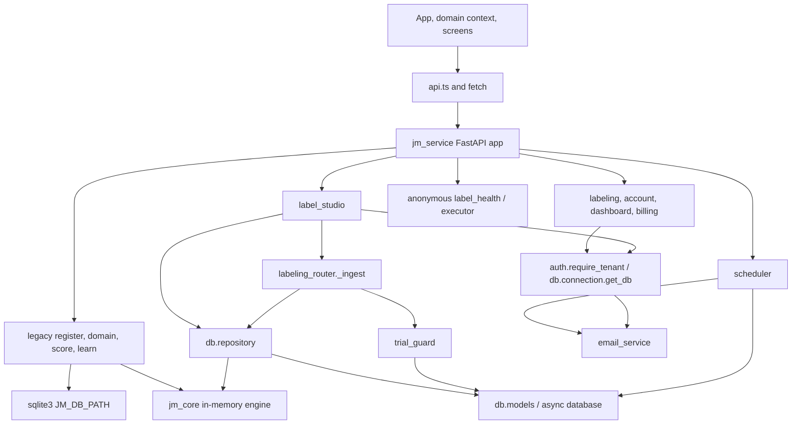

# DLJ architecture redesign v1

**Decision specification · 24 November 2026 · jm-service**

### Executive summary

Keep the public JM decision API and move its credentials, decision log and engine snapshots into the transactional store used by DLJ. Give every entitlement change and retention decision one serialized history under the owning tenant. Bind browser operations to an immutable account and project, and give connector and HTTP reviews the same revision and learning service. Require independently reviewed integration evidence whenever a change crosses one of these boundaries. The design targets all 24 distinct open P1s in the third-pass ledgers, with the live data cutover gated on a reversible staging rehearsal.

| Planned closure gate | P1s | Engineering days |
|---|---:|---:|
| P0 · contracts, test harness and release controls | 0 | 4 |
| P1 · signup, admission, validation and logging | 5 | 6 |
| P2 · billing, retention and billing migration | 5 | 9 |
| P3 · legacy storage and credential migration | 3 | 10 |
| P4 · unified project writes and connector persistence | 6 | 8 |
| P5 · browser ownership and explicit human outcomes | 5 | 6 |
| P6 · Railway cutover and recovery rehearsal | 0 additional | 4 |
| **Total** | **24 proposed, zero closed by this document** | **47** |

**Planning assumption.** Allow 24–30 working days with three engineers, an independent reviewer, and operations support. This covers the redesign, including overlapping portions of Post-Track 2. It does not deliver all twelve product prompts. Data reconciliation and external-client adoption can extend elapsed time. Risk is highest at the legacy writer handoff and during destructive retention. Keep deletion disabled during reconciliation, preserve a recoverable checkpoint, and promote only tenants with attributable ownership.

## 1. Current state diagnosis

The 26 round-one findings and the 30 round-two entries count issues within each report. They are not successive counts of distinct open defects. Round three records 20 backend and five frontend P1s. R13 and R3-07 are the same ground-truth defect, giving **24 distinct open findings**. The eight named structural P1s are a subset. The design builds on the actual round-two changes, including the existing checkout key ID, webhook receipts, cancellation cap, captured CSV credential and frontend build stage.



| Boundary | Dependencies, ownership and shared state today |
|---|---|
| Process and deployment | jm_service mounts routers, limiter, middleware and static assets and runs scheduled work via lifespan. Dockerfile builds frontend/dist in Node, installs the Python runtime and uses docker-entrypoint.sh for migration and startup. File-backed legacy SQL and connector configuration have different persistence requirements from the async database. |
| Legacy | A private sqlite3 get_db and get_tenant authenticate a raw bearer against tenants. Domain rows and decisions repeat that identity. jm_core operates on reconstructed state. Load, decision-log write and save_engine use separate connections. Legacy route names overlap the modern domain namespace, but their auth and backing tables differ. |
| DLJ identity and database | auth generates opaque keys and hashes them for lookup, stores tenant and digest in request-session info, and scopes public domain names by tenant. Signup is public, admin issuance uses X-Admin-Key. db.connection owns engine/sessionmaker, commit/rollback and SQLite FK setup. db.migrate upgrades existing schema then creates missing tables from db.models. |
| Label workflows | labeling_router imports repository, auth, core, trial_guard and policy evaluation. It orchestrates domain creation, reservation, scoring, verification, revision and content. repository persists engine versions, logs, annotations and evidence. dashboard_router reads tenant-scoped models/aggregates. account reads the authenticated key, domain mappings and cap constants. |
| Connector | label_studio imports router internals and repository. Its service token guards setup, tenant key plus service token guard project work. Configure uses a process lock and a JSON file. Predict calls ingest, while webhook verification/relearning takes a separate path. |
| Entitlement | billing authenticates checkout through DLJ, calls Paddle and processes signed webhook events in its own transaction. scheduler opens its own sessions for mail and deletion. trial_guard reserves on an API key, account reconstructs displayed limits, and both scheduler and billing mutate key lifecycle fields. None is a tenant-wide serialization boundary. |
| Browser | App, domain context, localStorage, hash navigation and storage events share selected identity. Upload captures a credential for batches. ScoredQueue, ReviewCard and other screens use api.ts with independent response and draft state. The signup and active-import exceptions to reload leave ownership gaps. |
| Public work | Anonymous report uploads retain bytes before admission to a two-worker executor. They share process memory and availability with authenticated routes. SlowAPI rate limiting and auth on other routes cannot bound these bytes. |

**Two representative request traces**

```text
Legacy POST learn → legacy credential lookup → load domain snapshot + durable decision
 → jm_core.learn → commit learned decision → separate snapshot commit → response
DLJ POST ingest → require_tenant → scoped domain → prepare engine → reserve key quota
 → jm_core.score → label + versioned state → policy evaluation → request commit/rollback
 → result with confidence and policy
```

Both use the same engine implementation and web process. They share deployment, resource exhaustion, route registration and operational failure domains. A DLJ transaction cannot roll back a legacy sqlite3 commit, a delivered email, a Paddle call or a config-file replacement.

| Structural P1 | Primary cause and missing invariant |
|---|---|
| R02 | Billing has two candidate owners, customer and purchaser. No command establishes which credential pays before accepting a provider transaction. |
| R03 | Independent connector and HTTP revision writers copy different fields. No contract requires the successor to retain evidence and provenance. |
| R06 | Separate legacy storage implements one learning command as multiple commits. No atomic decision-and-engine unit exists. |
| R07 | Legacy credential doubles as the ownership key. Reading business data reveals an authenticator. |
| R08 | Signup treats delivery to an address as proof that the HTTP requester controls it. This identity lifecycle gap exists even within the modern store. |
| R09 | Admission is local to computation. There is no aggregate budget at the HTTP upload boundary or resource test. |
| R23 | Migrations test column existence more thoroughly than ownership/value preservation across dialects. |
| R24 | Code assumes shared lock semantics across two dialects. Isolated test schemas alone cannot prove concurrent behavior. |

These defects have different mechanisms. Review gates and concurrency tests would have caught several, but neither can substitute for a transaction, a proof of mailbox ownership or an admission limit.

## 2. Legacy disposition — Option B, migrate to the unified store

Preserve POST /v1/register, GET/POST /v1/domains, POST score/learn and GET diagnostics/state, including current IDs, auth header, status codes and response bodies. Repo consumers include jm_api_demo.py, test_jm_service.py and the three Docker live suites. email_service.py also mentions legacy learn. Actual external usage requires route telemetry without credentials. Removing the API would require a client sunset. Process isolation alone would preserve plaintext keys and split commits. Option B intentionally supersedes just the v2 design's statement that JM keeps its own SQLite credential store.

Use the same digest lookup as DLJ, with an explicit credential audience. Existing modern keys default to dlj. Hash legacy keys locally during transfer, assign a stable independent tenant ID, and mark them jm. Digest collisions or ambiguous owners quarantine that mapping. Never auto-join owners by display name or email. Neither audience gains the other's routes, billing plan or data. Preserve the legacy pricing contract. Keep legacy decisions distinct from DLJ verified labels, and do not convert old confirmed flags into human correctness. The JM adapter stores the engine snapshot losslessly, retains old decision IDs and serializes score/learn by locking the JM domain before reading the snapshot. Conditional learn requires learned_at IS NULL. Decision mutation, snapshot save and version advance commit once.

**Implementation files.** Refactor jm_service.py into routing plus legacy_adapter.py. Add db/legacy_repository.py and scripts/migrate_legacy_jm.py. Modify auth.py, db/models.py, db/migrate.py, db/connection.py, docker-entrypoint.sh, railway.toml and Dockerfile. Keep jm_core.py's arithmetic frozen, adding a versioned centroid-key codec only where necessary. Preserve test_jm_service.py and Docker wire fixtures. New schema and inverse DDL appear in §6.

**Migration evidence.** Consistent SQLite backup plus a final delta under the writer fence. Verify owner/digest counts, domain and decision IDs, null/false distinctions, timestamps, state checksums, pending decisions and deterministic future score/learn parity. No raw key in PostgreSQL rows, artifacts, logs or migration reports. For each domain enumerate configured category/action pairs and map them to historical keys. Convert unique matches to a nested category→action dictionary, with compatibility encoding at the old state API boundary. Ambiguous historical weights cannot be split from a snapshot. Freeze learning for that domain, reconstruct only from complete ordered history with demonstrated parity or obtain owner-approved recovery. Retain evidence and mark as unresolved otherwise. Apply the P3 closure gate per affected domain.

**Rollback.** Before new writes, remove the canary route and continue on the fenced, verified old writer. After a new PG write, roll the application back to the prior adapter build that reads and writes PG. Do not point traffic at stale SQLite or reconstruct plaintext secrets. Keep a read-only encrypted snapshot with restricted access and expiry, rotate imported legacy credentials through a compatibility window, and expire plaintext-bearing backups or retire their bearer validity before declaring R07 closed. P3 addresses R06, R07 and R30.

## 3. Billing state machine

An API key is an actor credential. A subscription buys capacity for a specified billing key. A project belongs to an owner tenant. Use v2's ProjectBillingOwner for shared work, with canonical billing key and immutable original trial start. Before reconciliation, private DLJ accounts retain per-key ownership. For shared accounts, resolve and show the canonical payer before creating checkout. Persist the purchaser and payer separately in a checkout intent. Refuse an ambiguous payer before charging. Actors must belong to the purchasing account. Project members cannot buy or cancel on the owner's behalf.

**Transition contract.** Only transition(key, event, new_state) may change lifecycle, effective plan, subscription binding, cancellation date or retention eligibility. Validate the requested result against authoritative event type, status and current state. Use an internal typed event for scheduler/admin actions. Revoke/rotate credentials separately from ending a subscription. Map the provider status explicitly, including activated, trialing, paused, resumed, past_due, canceled and updated. Resumed is a transition from pause. A previously canceled subscription needs a verified replacement purchase for reactivation. [Paddle subscription events](https://developer.paddle.com/webhooks/subscriptions/subscription-resumed/)

| From | Trigger → target | Entitlement, retention and notification |
|---|---|---|
| No key | Verified registration/admin issue → trial | 50/day for 14 days from the original trial start. Account receives the credential only after commit. |
| Trial | Clock reaches expiry → trial_expired | Enforce immediately by time, even if scheduler lags. Queue expiry notice once. No chargeable scoring. |
| Trial, trial_expired, active, paused, past_due, cancelled | Verified new/replacement checkout with provider active status → active | Bind exact payer and unique subscription, apply known price/tier, invalidate previous retention generation, preserve counters. Record any superseded subscription binding. |
| Trial, trial_expired | Confirmed provider trialing → trial | Preserve original expiry ceiling unless there is a separately approved grant. Repeated events cannot restart trial. |
| Active, paused, past_due | Current subscription activated/resumed/updated with active status → active | Restore paid limit for valid current subscription. Paid tier changes require a recognized price. Notify once on state or plan change. |
| Active, trial, past_due | Current effective pause → paused | Suspend new paid scoring. Keep reads, account and checkout available. A scheduled future pause takes effect only at its effective instant. |
| Active, trial, paused | Current past_due → past_due | Proposed commercial policy: suspend chargeable work immediately, retain recovery/checkout, notify payer. Product owner approves grace policy before launch. |
| Trial, trial_expired, active, paused, past_due | Effective cancellation → cancelled | Accept cancellation by known subscription ID even for retired products. 50/day through retention, retain existing daily usage, no paid monthly limit. Notify and set deletion eligibility at effective cancellation + 30 days. |
| Cancelled | Scheduler at cutoff → cleaned_up | Under tenant guard, require all entitled siblings past eligibility, no protected/ambiguous ownership, and current provider reconciliation. Delete tenant data once, retire all eligible keys, record tombstones and committed transition. |
| Cleaned_up | Any old subscription event → unchanged | Tombstone is terminal. New purchase for a deleted account requires operator reconciliation or explicit new account onboarding. No promise to recover deleted data. |
| Any nonterminal | Same status/newer valid update → same | Record receipt, optionally update independently validated terms. Scheduled change, contact update or unknown product alone never grants capacity. |
| Any | Unknown type, stale event, duplicate or illegal transition | Acknowledge duplicate with same successful result, audit stale/unknown without advancing applied watermark, quarantine conflicts for resolution. No entitlement side effect. |
| Any nonterminal | Authorized operator correction | Require reason, provider evidence and unique command ID. Use one of the legal transitions above. Administrative disable affects credential authentication independently. |

All other pairs are forbidden. Provider-created notifications carrying a nonactive status take the matching permitted status path after intent validation. Admit verified first bindings directly into paused/past_due/cancelled when reconciliation establishes that as the first known provider state. Queue out-of-order events without enough binding data for reconciliation. Order by provider occurrence time per subscription, prefer effective cancellation over conflicting equal-time entitlement grants, reconcile other equal-time disagreements from Paddle. An unknown event cannot suppress a later known event. Process duplicate receipt IDs from the existing paddle_webhook_events table, including pre-upgrade receipts. Return 2xx for committed duplicates under the new contract and document the former 409.

**Serialization and side effects**

1. Verify signature before parsing trusted fields. Begin transaction, lock durable owner_tenant guard, then key(s) in UUID order FOR UPDATE, then project/domain, labels in stable order, then engine. Resolve checkout intent against transaction identity, customer, purchaser, payer and tenant. A pre-existing customer association is evidence to check, never authority to override a conflicting intent. When the provider call races its callback, reconcile by signed event and persisted intent, verifying transaction linkage with Paddle when necessary.
2. Lock the same guard for issuance, rotation, binding, shared writes, provider transitions and cleanup. On SQLite acquire the writer reservation with BEGIN IMMEDIATE **before the first relevant read**, including auth if it shares the transaction. Use conditional state/version updates, finite busy retry with a fresh unit of work, and stable idempotency keys. No network calls while holding locks.
3. Insert the receipt, state/version, applied watermark and transition_log in one commit. Audit applied, ignored, reconciled or quarantined dispositions with event ID, old/new state, actor and timestamps. Add durable notification intent in that commit. Dispatch after commit, retry with a stable delivery key. A notifier's failure cannot roll back entitlement.
4. One effective_entitlement resolver supplies trial_guard, account summary, scheduler, project administration, webhook and connector paths. Authenticates the actor separately from charging the payer. UTC day/month roll independently. Reserve only successfully charged work. Bulk partial success reports committed IDs. Trial expiry and cancellation never reset usage. Bind canonical accounts only after summing matching periods exactly once and preserving oldest applicable trial start.
5. Cleanup scans candidates outside the transaction. Re-read all sibling terms under the guard. Explicitly distinguish a key that can authenticate from an entitlement that protects data. Recheck deferred provider events and outstanding checkout intents. Block deletion on unresolved transitions or unavailable reconciliation. Reactivation that commits before the deletion decision preserves all data. If deletion commits first, the later event encounters a tombstone. A provider event never received by the service cannot be serialized with local deletion: use a final provider check, a cancellable grace/hold and a recoverable backup interval. Do not claim distributed atomicity with Paddle.

P2 targets R02, R14, R19, R23 and N05. R44/R18 remain regression gates. Keep data-preservation holds distinct from active paid quota.

## 4. Browser credential and request ownership

Today api.ts normally reads localStorage at dispatch. Upload already pins a key for each CSV run. Two other operations remain unsafe: a late signup response can replace a newly selected credential, and a stopped upload can leave a prior tenant's file and analysis available to restart. A project switch also changes the meaning of a label ID. Introduce one identity provider in App.tsx/domain.tsx and one command boundary in api.ts.

```ts
type RequestContext = Readonly<{
  credential: string | null
  accountEpoch: number
  projectEpoch: number
  projectId: string | null       // Domain.id UUID on the new surface
  publicDomain: string | null    // snapshot for old URLs
  operationId: string
  signal: AbortSignal
}>
```

The provider owns the in-memory credential, monotonic epochs and controller registry. beginOperation snapshots identity, project and signal. End the operation in finally. Pass the same context to all fetches, retries, polls, chunk commits and follow-up detail requests. Never serialize a context, log it or use its key as a cache key. Check ownership **before dispatch, after every await and before storage, cache, draft or navigation effects**. For a signup with no key, capture the anonymous epoch; adopt its returned credential through a compare-and-swap on that epoch. Abort alone cannot undo a committed server write.

On same-tab replacement, logout, cross-tab storage event or observed stored-key mismatch before dispatch, synchronously advance the epoch, abort all old controllers, purge account/project caches, file buffers, drafts, selection, receipts, timers and checkout flags. Check current storage on response application as well. A key rotation back to the same value within a tab still creates a new epoch. Use a generation nonce plus cross-tab notification for rotation across tabs. Keep only account-neutral progress text after abort. New uploads require explicit file selection. Keep raw keys out of URLs and telemetry. New verified registration exchanges a mailbox token (§6), then explicitly installs the credential in the owning tab.

On domain/project switch, invalidate every project operation before rendering its replacement. Use one scope for request and cache identity: account generation + project UUID + query/revision where applicable. Scope a queue selection to its page/filter/sort generation. Use one mutation lock in ReviewCard and CategorySelector for editing, verifying and relabeling. Disable editors during mutation, handle dirty navigation explicitly, and reload only the current revision on 409. Parse expected DTO shapes in api.ts, including nested required fields. Give lazy routes a recoverable error boundary that preserves navigation.

Apply the provider to App, Signup, Upload, ScoredQueue, ReviewCard, CategorySelector, Settings, Dashboard, AnnotatorProfiles and future Team, Invite and integrations screens. Distinguish the public report's anonymous authorization from ownership of the file displayed in a tab. For bulk truth, require independently observed outcomes, per item or an explicitly confirmed homogeneous group. Show skipped IDs and reasons. Stage a versioned bulk contract: unobserved work remains pending and cannot train. Migrate the queue first, measure older clients and retire inferred-truth writes before closing R13.

Prompt 01 freezes existing hash/API fixtures. Prompt 02 establishes the canonical UUID/owner binding, and Prompt 04 routes the provider through a nested project layout. Legacy public names still resolve through the owner's authenticated mapping. The server derives actor, ability and payer independently on every request. Client epochs prevent stale local actions, not server-side access violations. P5 targets R3-01, R3-02, R3-03, R3-08 and R13/R3-07.

## 5. Integration harness and release gates

Add integration/conftest.py, integration/test_identity_capacity.py, test_billing_retention.py, test_legacy_migration.py and test_project_writes.py in that directory, plus e2e/ownership.integration.spec.ts. Use pytest-asyncio, a real mounted FastAPI app, real repository and migrations, and a browser pointed at that app. One PostgreSQL schema **per scenario** is shared by all sessions, HTTP requests, scheduler and workers in that scenario. Different workers get different schemas. Exercise SQLite with an actual shared file, FK enforcement and independent connections. Assert the engine dialect and connection IDs before concurrency tests. Never direct fixtures at a shared live schema.

Use pytest fixtures for clock, local mail sink, Paddle sandbox-shaped transport and test keys. Hold at specific transaction boundaries. A pair of worker threads each owns its event loop and connection. Use threading.Barrier with timeout, or await the barrier through asyncio.to_thread when sharing an event loop. Set bounded lock timeouts. Coordinate browser request arrival/completion through the test server. Do not mock auth, ownership, billing transitions, commits, scorer or repository. Inspect committed rows from a third independent session and inspect the actual rendered result. Force both commit orders when the oracle differs. Record command IDs, schema version and redacted state transitions on failure.

**Target 32 named scenarios.** Dialect, route-adapter and ordering parametrizations are additional executions of these scenarios.

| # | Scenario | Required oracle / P1 |
|---:|---|---|
| 1 | New signup and mismatched mailbox | Only a consumed mailbox proof receives an active key, R08. |
| 2 | Concurrent proof consumption and mail failure | At most one credential, no precommit delivery, R08. |
| 3 | Concurrent anonymous uploads at admission limit | Early refusal before multipart buffering, measured total memory/queue depth remains bounded, R09. |
| 4 | Forced unhandled database failure through ASGI and scheduler | Captured server, worker and SQL logs contain no sentinel values, N02. |
| 5 | Malformed connector dispatch/results | Validate before access, controlled response and zero writes, N03/R31. |
| 6 | Identifier limits through all create/reuse paths | Same 422 and no writes on both dialects at max+1, success at max, R05/R11. |
| 7 | Checkout with two keys and existing customer | Exactly intended payer upgraded or ambiguous purchase refused before charge, R02. |
| 8 | Status sequence including past due, pause, resume and replaced subscription | Only the current subscription controls effective quota, R19. |
| 9 | Unknown, duplicate and delayed events amid cancellation | No watermark poisoning, double grant or duplicate notice, R19/R44. |
| 10 | Cleanup versus reactivation on separate connections | Renewal-first retains data, cleanup-first yields tombstone and reconciliation, R14. |
| 11 | Key creation and rotation during cleanup | One tenant-serialized decision, no live sibling loses data, R14. |
| 12 | Two old cancelled siblings versus one entitled sibling | First tenant cleaned exactly once, second preserved, N05. |
| 13 | Dual-dialect historical provider upgrade twice | Stored linkage and tenant ownership preserved or explicitly quarantined, R23. |
| 14 | Cancelled/paid UTC day and month boundaries | Summary agrees with last permitted reservation and rejection, R18. |
| 15 | Legacy schema import, auth replay and negative cross-audience calls | Stable owner/IDs, digest-only authoritative store, no new privileges, R07. |
| 16 | Learn failure injected between log and snapshot updates | Neither change persists; retry commits both once, R06. |
| 17 | Concurrent score and learn with one domain | Snapshot/version equals a serial execution, no double learn, R06. |
| 18 | Legacy centroid conversion including ambiguous state | Deterministic parity or blocked/quarantined domain, R30. |
| 19 | Shadow copy, fenced final delta and rollback-compatible binary | All last-minute writes and old pending decisions survive handoff, R06/R07. |
| 20 | HTTP and connector verification on an older reviewer engine | Same category sync, learning and conservation, R01. |
| 21 | Connector and HTTP revision of structured data | Common lineage, actor, text/NER/tags/image and current pointer, R03. |
| 22 | Two first-domain/engine writes | Consistent retry or 409, no partial records, R04. |
| 23 | Concurrent reservations at 49 plus two requests | At most one new charge and score, billing counters agree, R24. |
| 24 | Two relabels plus verify on one predecessor | One successor, stable training, controlled conflict on both dialects, R24. |
| 25 | Independent connector processes configure distinct projects | Both committed configs survive restart, R29. |
| 26 | Incorrect label corrected twice, including category reversion | Negative evidence persists until adjudication, R45. |
| 27 | Bulk approval, independent outcomes and a skipped item | Read stored action/outcome, learner trackers and counts, R13/R3-07. |
| 28 | Late signup after same-tab or cross-tab rotation | New credential still owns tab; abandoned signup cannot install a key, R3-01. |
| 29 | Rotation between real import chunks then restart | Only old owner has committed prefix; new owner has no file/draft or rows, R12/R3-02. |
| 30 | Domain switch with detail/search/bulk in flight, duplicated public IDs | Stale results cannot display, select or mutate the new project, F/P1.1, F/P1.4, S2.2. |
| 31 | Tag draft during category save/verify and navigation | Edit is blocked or explicitly preserved; no silent loss, R3-03. |
| 32 | Incompatible JSON and failed lazy chunk | Scoped error, usable navigation, recovery after retry, R3-08. |

**Change control.** Each implementation prompt names the invariant, all writers/readers, touched schema and rollback owner. Publish before/after OpenAPI fixtures and a migration diff with its PR. A second reviewer traces a normal call and its competing write. Serialize merges that touch the same transaction or request contract, rebase and rerun the combined tests on the merge candidate. Require real PostgreSQL concurrency, SQLite compatibility, browser acceptance and copied-data migration tests where their boundary changes. Release evidence includes failed-control evidence where feasible (the test distinguishes the known old behavior), both dialects, the image digest and rollback rehearsal. A green mocked browser test alone cannot authorize a persistence change.

## 6. Incremental execution and migration safety

| Phase | Dependencies, deliverable and gate | Engineering days / responsibility |
|---|---|---|
| P0 | Independently freeze legacy/DLJ wire fixtures and source manifests, create integration harness, record actual Railway volume, routing, version and provider subscription inventory. Install redacted route/latency/error metrics and establish the tested rollback image. First release may consist solely of CI. | 4, Codex plus reviewer and operations inventory |
| P1 | After P0, implement verified email challenge, bounded HTTP admission before multipart parsing, identifier/envelope validation and SQL error redaction in both web and scheduler. Stage new signup UI and versioned API before ending immediate dual delivery. | 6, Codex; product approves signup contract and limits |
| P2 | After P0, introduce the shared tenant lock and effective policy, migrate historical bindings, shadow FSM, then switch all lifecycle writers and account reads together. Suppress destructive cleanup during transition. | 9, Codex; billing owner resolves historical conflicts and approves status policy |
| P3 | After P0, build and reconcile Option B shadow storage and checkpoint. New writer cutover uses P6 procedure. Requires P1 safe logging and audience checks before production import. | 10, Codex; operations owns encrypted restore, traffic fence and key retirement |
| P4 | Begin services after P0. Integrate P2 lock order before enabling writes. Route HTTP, connector, tasks, bulk and sample through common commands; put connector config in DB. Introduce immutable review evidence, consistent current revisions, idempotency and bounded conflict handling. | 8, Codex plus scorer/repository review |
| P5 | Browser provider and draft protection can start after P0. Ship dual-readable contracts; enable observed-outcome-only writes with P4. Exercise actual signup and checkout returns from P1/P2. | 6, Codex plus browser acceptance |
| P6 | After integrated staging gates, canary by owner, rehearse promotion/hold/rollback, cut traffic and monitor. Only then contract obsolete writers. Leave unresolved tenants on their sole known-good path or hold destructive actions. | 4, operations/billing lead with independent go/no-go |

**Product decisions within these phases.** P1 issues short-lived, random single-use signup tokens. Store a digest and normalized email, deliver a confirmation link after commit, exchange proof transactionally and return the new key once to the confirming browser. Never email the same active credential to a second recipient. Expire/reissue pending tokens. Already-issued shared credentials require verified rotation/revocation before R08 closes for those accounts. Gate legacy registration behavior by route version during client migration. Enforce an ingress/body ceiling and early nonblocking admission **before** ASGI multipart decoding, plus an aggregate instance/replica budget for queued/disk-backed uploads; stream with a byte cap and release on disconnect/timeout. P1 centralizes safe error classification at framework, database driver and job boundaries, including suppression of bound values in third-party tracebacks.

P4 owns one revision command: lock the project and predecessor, reject stale tokens, make one successor, copy content and source lineage, record actor/time, and atomically set the predecessor pointer. Add missing category centroids through the same service on every learner path. One logical label contributes its latest *verified evidence* until a subsequent human adjudication replaces it. A pending correction alone cannot improve accuracy. Keep historical training events and chosen centroid update semantics explicit; do not silently “undo” training by excluding a row from a query. Apply this denominator to dashboard, autonomy and connector calculations. Replace config-file read/modify/write with a transactional upsert keyed by owner and project. Import the existing file once under a writer fence, reconcile all keys and publish the new reader before enabling new config writes.

**Compatibility contracts for intentional API changes.** Introduce POST /v2/auth/registration-challenges (202 after accepting a valid request) and POST /v2/auth/registration-challenges/confirm (201 with the credential after commit). Submit the proof in the request body, strip it from browser history at startup, and return 410 for an expired or consumed proof. Send a generic challenge response for a registered address and provide a mailbox-controlled rotation path. Move the SPA and documented clients first. Measure the old public signup route and announce its sunset; when the compatibility window ends, retire immediate issuance with an explicit upgrade response. Maintaining indefinite unverified issuance would keep R08 open. Keep the separate JM registration wire contract under its scoped audience.

For new bulk clients accept entries containing label_id, expected revision, action and independently observed boolean outcome. The existing approve/reject action retains its recommendation-agreement meaning. Reject duplicate IDs, cap at 200, authorize every row before any mutation, skip already-reviewed rows and stale revisions with per-ID dispositions, and preserve quota semantics. Old callers that explicitly supply a shared outcome may use the existing contract for homogeneous groups. Once implicit clients have migrated, reject missing truth with 422 or expose a distinct no-learning workflow. Do not silently reinterpret an old payload as human evidence.

### Schema ledger

The following is proposed PostgreSQL DDL, grouped by independent rollout. Use versioned migrations in db/migrate.py with catalog checks, explicit schema version and one migration runner. Preflight uniqueness before creating constraints. Reapplication must verify types and constraints as well as names. All IDs supplied by the service are UUIDv4; signed provider IDs remain bounded strings. On SQLite use SQLAlchemy Uuid/CHAR(32), TEXT for enum/JSON with equivalent CHECK constraints, UTC timestamp normalization and FK-enabled file transactions. Implement column/constraint removal on older SQLite by transactional table rebuild with explicit column lists, staged child rows, row counts and foreign_key_check. Run upgrade twice and inverse on restored fixtures. Inverses below are for a disposable rehearsal or after data has been reconciled/exported. Production binary rollback leaves additive schema in place.

**P1 — mailbox challenge.** Rate-limit by IP and normalized email. Supersede older tokens transactionally. Failure to deliver can be recovered by reissuing a challenge.

```sql
CREATE TABLE signup_challenge (
  token_digest char(64) PRIMARY KEY, email varchar(200) NOT NULL,
  requested_name varchar(200), expires_at timestamptz NOT NULL, consumed_at timestamptz
);
CREATE INDEX signup_challenge_email ON signup_challenge(email);
-- inverse, after pending challenges expire
DROP TABLE signup_challenge;
```

**P2 — identity guard, entitlement and audit.** Introduce the guard for *every* tenant before any key or project mutation. Insert-on-conflict followed by lock covers first use. Restrictive references and service-side owner checks protect the canonical payer; a composite FK below additionally prevents binding an unrelated tenant key. Rotate binding and terms under the guard. Checkout intent IDs go into Paddle custom_data alongside purchaser and payer; independently check the provider transaction. For a pre-existing subscription with no intent require unambiguous historical reconciliation. The established receipt PK continues to deduplicate prior deliveries.

```sql
CREATE TYPE subscription_lifecycle AS ENUM
 ('trial','trial_expired','active','past_due','paused','cancelled','cleaned_up');
ALTER TABLE api_keys ADD COLUMN subscription_state subscription_lifecycle;
ALTER TABLE api_keys ADD COLUMN state_version bigint NOT NULL DEFAULT 0;
CREATE TABLE tenant_guard (tenant_id varchar(200) PRIMARY KEY);
ALTER TABLE api_keys ADD CONSTRAINT uq_key_owner UNIQUE(tenant_id,id);
CREATE TABLE project_billing_owner (
 owner_tenant_id varchar(200) PRIMARY KEY REFERENCES tenant_guard(tenant_id),
 billing_key_id uuid NOT NULL UNIQUE, trial_started_at timestamptz NOT NULL,
 FOREIGN KEY(owner_tenant_id,billing_key_id) REFERENCES api_keys(tenant_id,id)
);
CREATE TABLE checkout_intent (
 id uuid PRIMARY KEY, tenant_id varchar(200) NOT NULL, purchaser uuid NOT NULL,
 payer uuid NOT NULL, tier varchar(20) NOT NULL, transaction_id varchar(200) UNIQUE,
 expires_at timestamptz NOT NULL, consumed_at timestamptz,
 FOREIGN KEY(tenant_id,purchaser) REFERENCES api_keys(tenant_id,id),
 FOREIGN KEY(tenant_id,payer) REFERENCES api_keys(tenant_id,id)
);
CREATE TABLE subscription_binding (
 subscription_id varchar(200) PRIMARY KEY, payer uuid NOT NULL REFERENCES api_keys(id),
 customer_id varchar(200) NOT NULL, retired_at timestamptz
);
CREATE UNIQUE INDEX one_current_sub ON subscription_binding(payer) WHERE retired_at IS NULL;
CREATE TABLE transition_log (
 event_id varchar(200) PRIMARY KEY, key_id uuid REFERENCES api_keys(id),
 subscription_id varchar(200), source varchar(32) NOT NULL,
 actor_ref varchar(200), occurred_at timestamptz NOT NULL,
 recorded_at timestamptz NOT NULL DEFAULT CURRENT_TIMESTAMP,
 old_state subscription_lifecycle, new_state subscription_lifecycle,
 disposition varchar(32) NOT NULL, reason_code varchar(64), key_version bigint
);
CREATE TABLE lifecycle_notice (
 event_id varchar(200) REFERENCES transition_log(event_id),
 kind varchar(40), delivered_at timestamptz, PRIMARY KEY(event_id,kind)
);
-- inverse, after disabling all new writers and preserving audit
DROP TABLE lifecycle_notice, transition_log, subscription_binding, checkout_intent, project_billing_owner;
DROP TABLE tenant_guard;
ALTER TABLE api_keys DROP CONSTRAINT uq_key_owner;
ALTER TABLE api_keys DROP COLUMN state_version, DROP COLUMN subscription_state;
DROP TYPE subscription_lifecycle;
```

Add subscription_state nullable first. Dual-read old tier/cancel fields during backfill. Infer cancelled from cancellation time, trial expiry from original UTC start, paid terms from verified provider binding. An inactive key does **not** prove cleanup. Hold ambiguous keys for reconciliation. Do not advance entitlement/retention for them based on guesses. Preserve daily/monthly counters and receipts. For R23, inventory old and new provider columns on both dialects, copy only attributable nonconflicting values, and confirm they really identify Paddle subscriptions or require an operator mapping from the former provider. Keep old columns. Dry-run outputs IDs/counts without emails or tokens. Persist a protected before/after manifest for conditional restoration. For final enforcement on applicable DLJ keys validate a CHECK that state is non-null for that audience; remove this check first on downgrade. Legacy-only keys are excluded from billing and cleanup. The canonical table is the v2 ProjectBillingOwner, so Prompt 02 must reuse it.

**P3 — legacy adapter.** Add the audience field ahead of P2 if those phases run in parallel. Add the audience check to both authenticators before any imported credential becomes readable. Use a fresh UUID-derived tenant identifier per historical bearer, maintain digest→tenant mapping in api_keys, and reuse that mapping on repeat runs. Existing DLJ keys remain audience dlj. Keep JM name and floating Unix timestamps as stored in the old contract; JSON arrays retain ordering. UUID constraints apply only to internal IDs. The legacy public identifiers remain opaque strings.

```sql
ALTER TABLE api_keys ADD COLUMN credential_audience varchar(8) NOT NULL DEFAULT 'dlj'
 CHECK (credential_audience IN ('dlj','jm'));
CREATE TABLE jm_domain (
 domain_id text PRIMARY KEY, owner_key_id uuid NOT NULL REFERENCES api_keys(id),
 config_json json NOT NULL, state_json json NOT NULL, version bigint NOT NULL DEFAULT 1,
 created_at double precision NOT NULL, updated_at double precision NOT NULL
);
CREATE INDEX jm_domain_owner ON jm_domain(owner_key_id);
CREATE TABLE jm_decision (
 decision_id text PRIMARY KEY, domain_id text NOT NULL REFERENCES jm_domain(domain_id),
 factors_json json NOT NULL, category text NOT NULL, recommended_action text NOT NULL,
 confidence double precision NOT NULL, actual_action text, confirmed boolean,
 scored_at double precision NOT NULL, learned_at double precision
);
CREATE INDEX jm_decision_domain ON jm_decision(domain_id);
-- final state check, after P2/P3 reconciliation and complete writer rollout
ALTER TABLE api_keys ADD CONSTRAINT ck_dlj_state
 CHECK (credential_audience <> 'dlj' OR subscription_state IS NOT NULL) NOT VALID;
ALTER TABLE api_keys VALIDATE CONSTRAINT ck_dlj_state;
-- inverse in this order; preserve post-cutover records before contraction
ALTER TABLE api_keys DROP CONSTRAINT ck_dlj_state;
DROP TABLE jm_decision, jm_domain;
-- Remove or archive imported JM key rows before removing the audience discriminator.
ALTER TABLE api_keys DROP COLUMN credential_audience;
```

Check that each legacy decision tenant matches its legacy domain before importing. Ownership is then inherited from the domain. Preserve the historical owner identity across rotation: update that owner's domain FK references and replace/deactivate the old credential in one transaction, or rotate the digest in place with authorization. Never silently repurpose a JM key as a DLJ credential. Preserve the existing contact field/index on DLJ signups; leave imported JM contact null. No source schema change is needed for a snapshot plus final fenced comparison. Benchmark full comparison on a restored copy. If it cannot finish inside the request budget, require an online change journal before cutover.

**P4 — shared writes.** Make existing superseded_by and prior_revision_id the only chain, validate existing duplicate links and scope before index creation, and update the current pointer with a predicate on the expected old revision. Provide one durable config row per project. Use an operation receipt for mutating imports and retries where the legacy contract lacks a natural stable key. This is the v2 ProjectRequest table, shared with Prompt 05. Never index a caller-supplied secret. Display latest verified evidence per logical root through the lineage, backfilling stable source_task_id on historical rows only where ownership and linkage are unambiguous. A conflicting chain pauses that project's automated decisions pending review.

```sql
CREATE UNIQUE INDEX uq_revision_predecessor ON label_log(domain_id,prior_revision_id)
 WHERE prior_revision_id IS NOT NULL;
CREATE TABLE connector_config (
 tenant_id varchar(200) NOT NULL, project_id varchar(200) NOT NULL,
 config_json json NOT NULL, version bigint NOT NULL DEFAULT 1,
 PRIMARY KEY(tenant_id,project_id)
);
CREATE TABLE project_request (
 project_id uuid NOT NULL REFERENCES domains(id), actor_key_id uuid NOT NULL REFERENCES api_keys(id),
 operation varchar(40) NOT NULL, request_key varchar(200) NOT NULL,
 payload_digest char(64) NOT NULL, result_json json NOT NULL, expires_at timestamptz NOT NULL,
 PRIMARY KEY(project_id,actor_key_id,operation,request_key)
);
-- inverse after draining writers, reconciling config and retaining replay receipts through expiry
DROP TABLE project_request, connector_config;
DROP INDEX uq_revision_predecessor;
```

For SQLite historical provider repair, backfill with conditional UPDATE statements only for verified mapping pairs. The inverse restores only rows that still match the recorded migrated value and version. For codec, config, lineage and ownership backfills, use the same compare-before-restore rule; arbitrary reconstruction of overwritten data is unsafe. The inverse to post-validation NOT NULL/CHECK enforcement on SQLite is the same FK-safe rebuild without that check. P0/P5/P6 require no application schema. Future v2 project membership, invitations, prediction and outbound webhook tables remain under their original prompts.

### Railway rollout, cutover and rollback

1. Inventory actual service routes, writable volumes, backups, live legacy traffic, DB owner, data size, DNS/proxy ownership and Paddle delivery settings. Restore both stores into staging. Set numerical gates before rollout: zero unexplained owner/row/state differences, zero duplicate charges or cross-owner writes, zero lost acknowledged writes, and no cutover timeout at measured peak with headroom. Archive the release image and verify restore access.
2. Use a single migration runner with a migration lock, bounded lock_timeout and retry. Add nullable fields and new tables before readers. Create large indexes concurrently on PostgreSQL in separate nontransactional steps, validate and attach constraints afterwards, and check failed/invalid indexes before retry. Verify catalog/schema on readiness. Flags are independently reversible per phase/tenant. Old and new containers can coexist only while their writes are compatible. Keep destructive background jobs single-leader or disabled until every writer uses the guard.
3. For strict zero downtime put a stable routing layer in front of the current healthy service and a separate ready, volume-free PG-backed deployment. Route legacy calls to their **single existing writer** during shadow copy. Move DLJ only after verifying both ingress paths and transferring background-job ownership. Do not mount the same SQLite volume on two deployments. Railway explicitly documents a redeployment gap for a service with an attached volume; health checks alone do not remove it. If routing, control over all writers, or bounded handoff cannot be demonstrated, do not enable the switch. [Railway volume caveats](https://docs.railway.com/volumes/reference#caveats)
4. Snapshot online using SQLite's backup API on the owning service; copy encrypted and hash credentials in the trusted importer. Shadow compare continuously. At cutover the router briefly **queues** JM mutations, drains admitted work, and fences the old writer including direct/internal ingress. Reads continue on the old authoritative snapshot until promotion. Reconcile inserts and changes since checkpoint, verify counts/state and route epoch, then atomically switch reads/writes and release queued writes once. Bound admission and queue time below client timeouts; use a durable gateway command identity for accepted mutations and never blindly replay a request with an unknown result. The source must be fenced against writes for the entire final verification. Use a smaller canary owner or change journal if the rehearsed delta exceeds the allowed handoff time. For new registration route by writer epoch as it has no existing owner.
5. A provider webhook must have a single active ingestion route even during blue/green overlap. Drain or durably queue authenticated events while transferring billing writers; reconcile missed events by provider ID before destructive cleanup. Build and smoke-test the actual image, SPA bundles, the static sample and old hash URLs. Move connector config into DB or explicitly pin configure requests to their old writer until its transfer completes.
6. Before new writes, rollback routes to the old writer and drain the buffer there. After new writes, roll back behavior through the compatibility binary against the current DB. Leave subscription receipts, transitions, new credentials and acknowledged writes intact. No ordinary rollback runs DROP statements. Stop the rollout on unexpected owner differences, increasing errors/latency, stale shadow policy or ambiguous subscription state. Operator approves any irreversible deletion, historical data reconciliation or retirement of backup credentials separately.

**Post-Track 2 alignment**

| Prompt | Effect of this redesign |
|---|---|
| 01 | Extend with P0 concurrency harness, data manifests, route audiences and deployment evidence. |
| 02 | Modify and reuse P2 tenant guard, canonical billing binding and reconciliation. Project UUID is Domain.id. Existing engine domain IDs and public aliases retain their meaning. P3 changes only the separate JM persistence decision. |
| 03 | Build roles, invitations and ProjectAccess on P1 verified identity and P4 commands. Invited actors never inherit the payer credential or its account endpoints. |
| 04 | Implement P5 context provider as the nested router's common ownership boundary. |
| 05 | Reuse P4 transaction/receipt and P2 reservation primitives for typed batch ingest. |
| 06 | Export through authorized project scope and a consistent read snapshot. Gate on revision/content parity and tested evidence semantics. |
| 07 | Publish actual signup, scope, bulk and error contracts after P1/P4/P5. Execute the client against both route families. |
| 08 | Use common revision provenance, adjudicated evidence and payer reservation. A machine prediction never becomes verified without a human outcome. |
| 09 | Extend P5 queue/review on top of 04/08. Require query-bound selection and per-item truth. |
| 10 | Use P2/P4 transaction boundaries and P0 multi-worker fixtures for outgoing project events. Paddle receipt history and outbound delivery history are distinct. |
| 11 | Build integrator settings on P5 role/context and 10's delivery contract. Verify scope on secret reveal and rotation. |
| 12 | Incorporate P6 restored-copy rehearsal, mixed-version compatibility, image probe, real concurrent writes and browser identity tests. |

No numbered prompt is removed wholesale. P0 replaces duplicated foundation work in 01, P2 replaces ad-hoc billing edits in 02, and P4/P5 replace parallel implementations of the same write and browser contracts. The original v2 30-day estimate and the 47-day redesign overlap; do not sum them as independent projects.

## 7. P1 closure map

A closure requires the listed observable behavior in the deployed writer, with passing acceptance evidence on the release candidate. The phase identifies who owns the fix. P6 controls production rollout. The four recurring causes are abbreviated here as **storage** (split identity/storage), **billing** (distributed entitlement decisions), **contracts** (independent feature implementations), and **harness** (missing cross-boundary verification). A missing test is a contributing cause wherever the table names a runtime invariant.

| P1 ID | Description | Root cause | Redesign phase | Closes when |
|---|---|---|---|---|
| R08 | Shared credential before mailbox proof | Storage/identity lifecycle | P1 | Confirmation precedes issuance, single-use exchange works, pre-existing shared keys rotated or revoked. |
| R09 | Unbounded anonymous report waiters | Contracts/harness, admission after allocation | P1 | Overload tests bound aggregate bytes and waiters before multipart parsing. |
| N02 | DB parameters can reach outer logs | Contracts, local-only redaction | P1 | Server, driver and scheduler logs omit sensitive sentinels on unhandled failures. |
| N03 | Connector dispatch can fail before validation | Contracts | P1 | All envelope types produce an intentional response without side effects. |
| R05 | Derived/path identifiers exceed DB limits | Contracts, alternate writers | P1 | Every persisted ID is validated before first use on each dialect. |
| R02 | Customer binding overrides purchaser | Billing | P2 | A signed checkout resolves to exactly its recorded payer or enters reconciliation; paying key receives expected capacity. |
| R14 | Cleanup and reactivation/key issuance race | Billing/harness | P2 | Competing transactions serialize at tenant scope, fresh entitled siblings protect the dataset, terminal cleanup cannot be silently revived. |
| R19 | Unsupported states and replacement subscriptions | Billing | P2 | Dispatched statuses, superseded IDs, unknown events and reactivation converge to verified provider terms without dropping known transitions. |
| R23 | SQLite loses provider linkage / old scope | Storage/harness | P2 | Repeat migrations reconcile historical value and owner on both dialects; ambiguous data stays protected until manually attributed. |
| N05 | Cancelled siblings retain each other forever | Billing | P2 | All-expired siblings clean once while an actually entitled sibling blocks deletion. |
| R06 | Legacy decision and snapshot split | Storage | P3 | Each successful score/learn has one serializable outcome, including interruption and retry. |
| R07 | Raw legacy keys persist as identities | Storage | P3 | Live tables use digests, old credentials in backups are expired/rotated or backups securely retired. |
| R30 | Historical centroid-key collisions | Storage/contracts | P3 | New inputs cannot collide, all legacy pairs are migrated uniquely or reconciled with evidence and owner approval. |
| R01 | Connector learns on obsolete category schema | Contracts | P4 | HTTP and connector synchronize the same reviewer engine and yield equivalent learned state. |
| R03 | Connector correction loses structured content | Contracts | P4 | Both adapters preserve lineage, text and structured annotations on the current revision. |
| R04 | Competing first writes return backend errors | Contracts/harness | P4 | Domain and engine creation converge or return a retryable conflict without partial writes. |
| R24 | SQLite lacks assumed row locks | Storage/harness | P4 | Integration lanes prove quota, revision and retention invariants using dialect-appropriate transactions. |
| R29 | Multi-process configure loses a project | Storage/contracts | P4 | Two workers can commit distinct project configs and both persist after restart. |
| R45 | Revisions remove negative accuracy evidence | Contracts | P4 | Revision alone cannot alter the verified denominator or erase a negative, including a category round trip. |
| R13 = S1.3 = R3-07 | Bulk action manufactures truth | Contracts/harness | P5 | Normal UI and every accepted write contract require independent observed truth for learning; mixed outcomes round-trip. |
| R3-01 (S1.1 residual) | Late registration replaces the active identity | Contracts/harness | P5 | Older registration cannot mutate storage, scope or UI after replacement/navigation. |
| R3-02 | Aborted import exposes reusable previous-account input | Contracts/harness | P5 | Key rotation erases files, report and text drafts; a new account cannot restart with the old file. |
| R3-03 (S2.1 residual) | Concurrent mutation discards review drafts | Contracts/harness | P5 | Dirty navigation and every mutation coordinate; permitted edits survive or are explicitly discarded. |
| R3-08 | Incompatible JSON or lazy import breaks application shell | Contracts | P5 | Runtime DTO validation and route error boundaries keep navigation and retry available. |

**Earlier findings, with their original namespaces.** “Closed” refers to the named mechanism already fixed. Distinct later findings retain their own release gates above.

| Round-one backend ID | Prior report disposition → current P1 mapping |
|---|---|
| B/P1.1 | CLOSED. Missing live webhook secret fails closed. |
| B/P1.2 | Scored HTTP category checks landed. Connector gap remains R01. |
| B/P1.3 | CLOSED. Historical timestamp type/UTC repair. |
| B/P1.4 | CLOSED. SQLite rebuild stages/restores structured children. |
| B/P1.5 | Checkout carries key UUID. Conflicting customer precedence remains R02. |
| B/P1.6 | CLOSED for stale-event revival and receipt replay. R14/R19 are separate lifecycle failures. |
| B/P1.7 | Open as R03. |
| B/P1.8 | Partially fixed at HTTP creation. Remaining collision paths R04. |
| B/P1.9 | Request model ID caps landed. Derived and path ID gap R05. |
| B/P1.10 | CLOSED. Secondary email conflict is isolated by savepoint. |
| B/P1.11 | Open as R06. |
| B/P1.12 | Open as R07. |
| B/P1.13 | Open as R08. |
| B/P1.14 | Open as R09. |
| B/P1.15 | CLOSED. Bad product no longer grants a default tier or crashes product lookup. Cancellation-specific R44 also closed. |
| B/P1.16 | CLOSED. Legacy range bounds validated before indexing. |
| B/P1.17 | CLOSED for HTTP disclosure and later batch-handler logging R35. Outer exception logging remains N02. |
| B/P1.18 | Reclassified R10/P3. Anonymous report computation is an intended product surface. Its resource risk is R09. |
| B/P1.19 | CLOSED for the prediction/item-validation failures including R11. Separate R05/N03 remain. |

| Earlier frontend and round-two IDs | Prior mechanism and current disposition |
|---|---|
| F/P1.1 | CLOSED. Late detail cannot verify a different displayed label. |
| F/P1.2, S1.1 | Normal key replacement clears scope. Outstanding signup adoption is R3-01; upload buffer ownership is R3-02. |
| F/P1.3, S2.1 | CLOSED for approval with an existing dirty span/tag draft and editing during span/tag save. Other overlapping mutations remain R3-03. |
| F/P1.4, S2.2 | CLOSED for stale-domain rows and stale-query bulk submission. |
| F/P1.5 | CLOSED for writing another domain's guidelines draft. |
| F/P1.6, S1.2, R12 | CLOSED for splitting a running import across credentials. Restarting retained input is distinct R3-02. |
| F/P1.7, S1.3 | Open as R13/R3-07. |
| S3.1 | CLOSED for accepting HTML as a JSON DTO. The different valid-JSON/wrong-shape case is R3-08. |
| S7.1 | CLOSED for missing build stage. Require an actual container smoke in P6. |
| R11, R18, R31, R35, R44 | CLOSED for numeric/item-boundary errors, cancelled-key paid capacity, malformed annotation result entries, SQL values in batch-handler logs and unknown-product cancellation respectively. |
| R14, R13, R30, R45, R29 | PARTIAL round-two fixes; all five retain explicit closure gates above. |

**Coverage and limits.** The redesign assigns all 24 open P1s to a phase. Architecture alone closes none. Commercial decisions on past-due behavior, unattributable historical owner/provider records, irrecoverably collided centroids and credential-bearing backups require human reconciliation. Keep those findings open for affected tenants until their gate is met. P6 does not assert a live cutover, a passed new test suite or historical recovery in the absence of evidence.

**Design inputs.** Current contracts and historical counts come from docs/session_state.md, docs/design/dlj_post_track2_design_v2.md, and the backend and frontend reports for all three sweeps under docs/quality/. The round-three ledgers are dlj_sweep3_backend.md and dlj_sweep3_frontend.md. Use those namespaces when filing implementation work.
